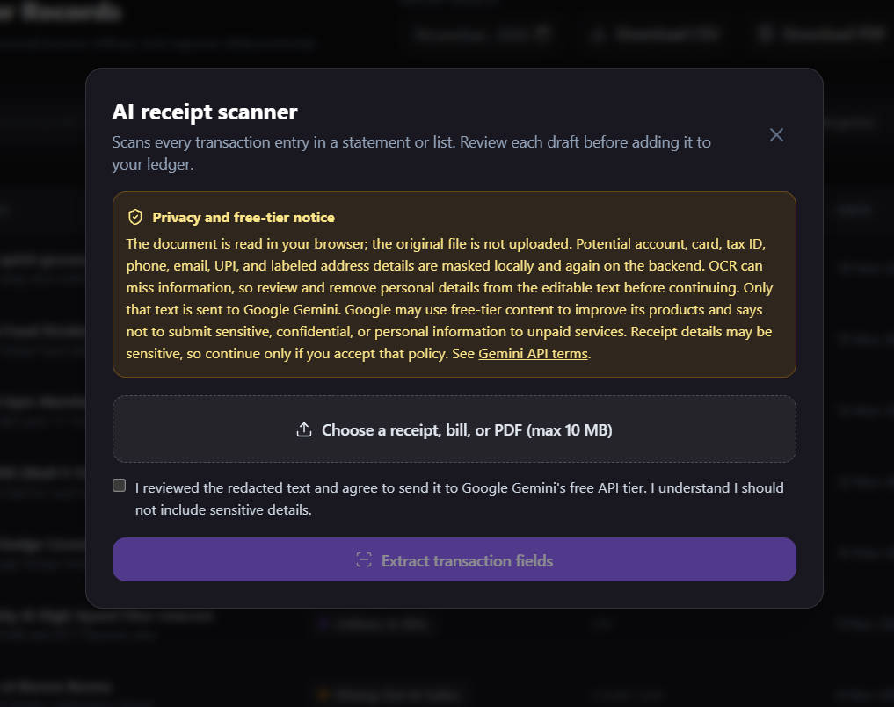
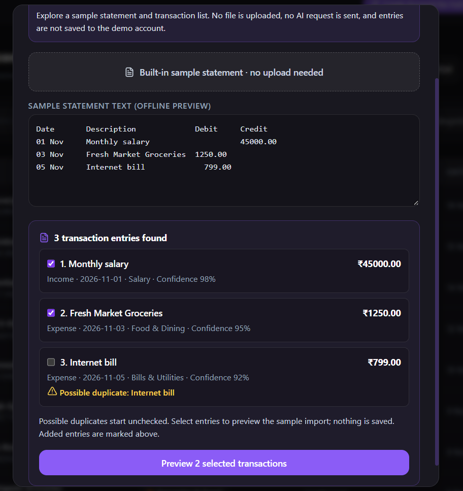
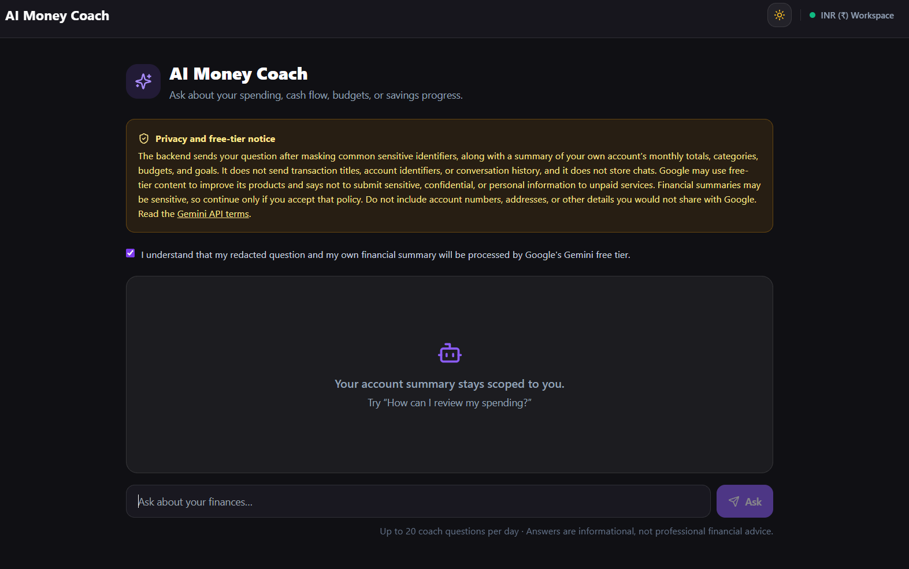
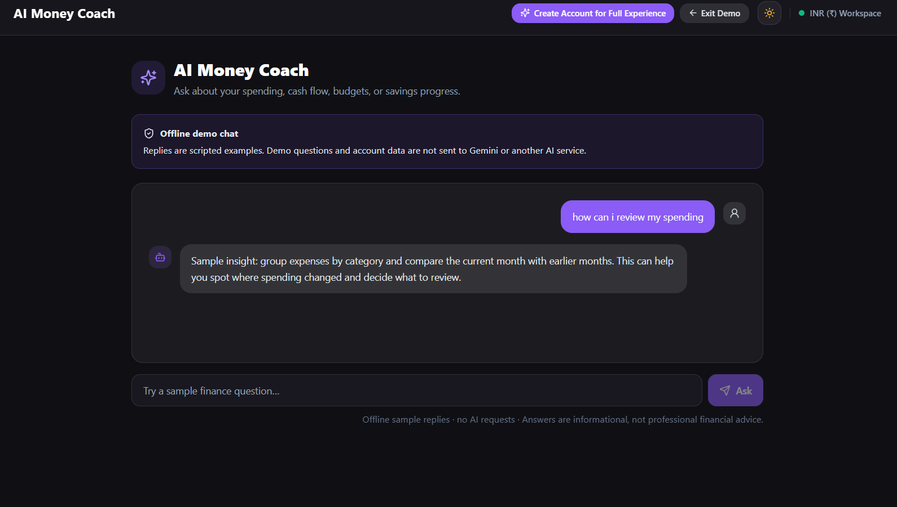

# WealthPulse — AI-Powered Personal Finance Tracker

WealthPulse is an AI-assisted personal finance tracker for recording income and expenses, setting budgets and savings goals, and reviewing cash flow. It includes a dashboard, reports, recurring transaction rules, monthly CSV/PDF exports, an AI transaction document scanner, and an AI Money Coach.

**Live application:** [wealth-pulse-money-manager.vercel.app](https://wealth-pulse-money-manager.vercel.app/)

**Backend API health:** [wealth-pulse-lake.vercel.app/api/health](https://wealth-pulse-lake.vercel.app/api/health)

## Features

- Account registration, sign in, profile preferences, and password changes.
- Income and expense tracking with categories, dates, notes, and payment methods.
- Search, category and type filters, sorting, and pagination for transactions.
- Monthly budget tracking with spending progress and over-budget amounts.
- Savings goals with contributions and withdrawals.
- Recurring transaction rules for regular income and expenses.
- Dashboard **summaries**, **charts**, **reports**, and **rule-based financial insights**. Dashboard insights are calculated directly from account data and do not use the optional Gemini service.
- Quick dashboard shortcuts: select the income or expense total card to open a new transaction form with that transaction type preselected.
- Monthly transaction exports in **CSV** and **PDF**. The PDF preview includes total income, total expenses, and net cash flow.
- Interactive demo account and **dark** and **light** themes.
- **AI transaction document scanner:** extracts PDF text or runs image OCR in your browser, then uses Gemini to identify individual transaction entries. Review the list, leave possible duplicates unchecked or select them if needed, and add selected entries together. Imported, skipped, and failed entries are marked in the review list.
- **AI Money Coach:** ask about spending, cash flow, budgets, and savings. Gemini explains calculations based on a summary of the signed-in user's own financial data. The latest 15 redacted chat exchanges are saved per account and can be cleared in the chat. Previous exchanges are not sent to Gemini. Demo accounts use scripted offline sample replies and a sample scanner preview; neither sends requests to Gemini or saves sample transactions.
- Email verification and password recovery are optional and require backend SMTP configuration. Without SMTP configured, those email features are unavailable; signed-in users can still change their password in Profile settings.

## Technology stack

| Area | Technologies |
| --- | --- |
| Frontend | **React 18, Vite, React Router, Tailwind CSS, Recharts, Lucide React, PDF.js, Tesseract.js** |
| Backend | **Node.js, Express 4, Mongoose** |
| Database | **MongoDB Atlas** |
| AI integration | **Google Gemini API (`gemini-3.1-flash-lite`) for transaction extraction and the Money Coach; API calls and key stay on the backend** |
| Document processing | **PDF.js for PDF text extraction and Tesseract.js for browser-side image/scanned-page OCR** |
| Validation | **Zod** |
| Authentication | **bcryptjs password hashing, JSON Web Tokens, HTTP-only cookies** |
| Email | **Nodemailer with SMTP configuration** |
| Security | **Helmet, CORS, express-rate-limit** |
| Backend checks | **Node.js test runner, Supertest, mongodb-memory-server** |
| Version Control | **Git, GitHub** |


## Screenshots

### Landing page


### Login and registration


### Dashboard


### AI transaction scanner

<!-- Add a screenshot of the scanner's extracted transaction list and duplicate indicators. -->


### Demo working


### AI Money Coach

<!-- Add a screenshot of the AI Money Coach conversation screen. -->


### Demo working 


### Transactions and downloads


### Budgets


### Savings goals


### Recurring 


### Reports and analytics


### Light and dark themes


## Project structure

```text
.
├── backend/
│   ├── index.js          # Vercel serverless Express entry point
│   ├── src/
│   │   ├── config/       # Environment and database setup
│   │   ├── controllers/  # API handlers
│   │   ├── middleware/   # Authentication, validation, rate limits, errors
│   │   ├── models/       # Mongoose models
│   │   ├── routes/       # Express routes
│   │   ├── services/     # Email, AI, insights, recurring transactions
│   │   ├── utils/        # Tokens, currency, seed helpers
│   │   ├── validators/   # Zod request schemas
│   │   ├── app.js        # Express middleware and route setup
│   │   └── server.js     # Configuration, database connection, listener
│   ├── tests/            # Backend API tests
│   └── package.json
├── frontend/
│   ├── public/           # Static assets and favicon
│   ├── src/
│   │   ├── components/   # Shared UI, layout, and receipt scanner
│   │   ├── context/      # Authentication and theme state
│   │   ├── pages/        # Application screens, including AI Money Coach
│   │   ├── services/     # API client and browser document extraction/redaction
│   │   ├── utils/        # Formatting helpers
│   │   ├── App.jsx       # Application routes
│   │   └── main.jsx      # React entry point
│   ├── index.html
│   ├── vite.config.js
│   └── package.json
├── README.md
└── DEPLOYMENT.md
```

## Clone and run

### Requirements

- Node.js 20 or newer and npm.
- A MongoDB connection for persistent account data.

### 1. Clone the repository and install dependencies

```bash
git clone <repository-url>
cd <repository-directory>
cd backend
npm install
cd ../frontend
npm install
cd ..
```

### 2. Configure environment variables

Create your own `backend/.env` and `frontend/.env` files. These files are ignored by Git and must never be committed. Frontend `VITE_` variables are included in the browser build, so do not put secrets in the frontend environment.

#### Frontend environment variables

| Variable | Required | Purpose |
| --- | --- | --- |
| `VITE_API_URL` | No | API base URL, ending in `/api`. Defaults to `/api`. This is public configuration. |

Example `frontend/.env`:

```env
VITE_API_URL=http://localhost:5000/api
```

#### Backend environment variables

| Variable | Required | Purpose |
| --- | --- | --- |
| `JWT_SECRET` | Yes | Private key used to sign authentication tokens. |
| `COOKIE_SECRET` | Production | Cookie-parser secret; must be at least 32 characters in production. |
| `MONGODB_URI` | Production | MongoDB connection URI. Optional for development. |
| `FRONTEND_URL` | Production | Exact HTTPS frontend origin allowed by CORS and authenticated requests. |
| `PORT` | No | API port; defaults to `5000`. |
| `NODE_ENV` | No | Runtime mode, such as `development` or `production`. |
| `EMAIL_HOST` | No | SMTP host. Required with `EMAIL_USER` and `EMAIL_PASS` to enable email. |
| `EMAIL_PORT` | No | SMTP port; defaults to `587`. |
| `EMAIL_USER` | No | SMTP username. |
| `EMAIL_PASS` | No | Private SMTP password. |
| `EMAIL_FROM` | No | Sender address used for email. |
| `GEMINI_API_KEY` | No | Private Google Gemini API key; enables AI chat and receipt scanning. Must stay in the backend environment. |

Example `backend/.env`:

```env
NODE_ENV=development
PORT=5000
MONGODB_URI=<your-mongodb-connection-uri>
JWT_SECRET=<your-private-development-value>
COOKIE_SECRET=<your-private-cookie-value>
FRONTEND_URL=http://localhost:5173

# Optional: omit these to keep email verification and password recovery disabled.
EMAIL_HOST=
EMAIL_PORT=587
EMAIL_USER=
EMAIL_PASS=
EMAIL_FROM=WealthPulse <noreply@example.test>
GEMINI_API_KEY=your_gemini_api_key_here
```

All backend credentials must remain in the backend environment and must not use the `VITE_` prefix. Production requires `MONGODB_URI` and `FRONTEND_URL`; `JWT_SECRET` and `COOKIE_SECRET` must each be at least 32 characters. Keep `.env` files private. `GEMINI_API_KEY` is optional; without it, the rest of WealthPulse works and AI endpoints report that AI is not configured.

The scanner extracts PDF text and runs OCR in your browser. It sends only editable, redacted extracted text to the backend; the original document is not uploaded. Review the text because automated redaction can miss details. The chatbot sends your current question and an aggregate summary of your own financial data, not individual transaction titles or previous chat messages. The backend stores up to 15 redacted exchanges per account in MongoDB Atlas; clear them from the chat screen at any time. Both AI screens ask for consent. Google's Gemini API terms say unpaid-tier content may be used to improve Google products and advise against submitting sensitive, confidential, or personal information; financial details may be sensitive, so use the AI tools only if you accept that policy. Use a Gemini free-tier project with billing disabled to avoid paid API usage.

### 3. Start the backend

```bash
cd backend
npm run dev
```

The API listens on `http://localhost:5000`. Its health endpoint is `http://localhost:5000/api/health`.

### 4. Start the frontend

In a second terminal, from the repository directory:

```bash
cd frontend
npm run dev
```

Open `http://localhost:5173`. Vite forwards `/api` requests to the backend.

## Deployment

- **Frontend:** Deployed on Vercel
- **Backend:** Deployed on Vercel (Serverless Functions)
- **Database:** MongoDB Atlas
- **Live Website:** https://wealth-pulse-money-manager.vercel.app/

The application is deployed as a full-stack web application with cloud-hosted frontend, backend APIs, and database infrastructure.

## Security overview

Passwords are hashed with bcryptjs. Authentication uses seven-day JWTs in HTTP-only cookies. Password changes invalidate previous sessions, protected data is scoped to the authenticated account, request bodies are validated, and sensitive authentication endpoints are rate-limited. Helmet provides security headers. Keep private backend credentials out of frontend configuration and source control.

Email verification and password recovery require configured SMTP delivery. Without SMTP, the application does not create or log mock links, and password recovery is disabled. Users who are signed in can change their password from Profile settings.

## Future improvements

- Configure a production **email provider** for **account verification** and **email-based password recovery**.
- Add optional bank transaction imports.
- Add more export formats and customizable report periods.
- Add broader OCR language support and additional local redaction patterns.

## Author
### DIVYA RAVINDRA PAI
Engineering student
