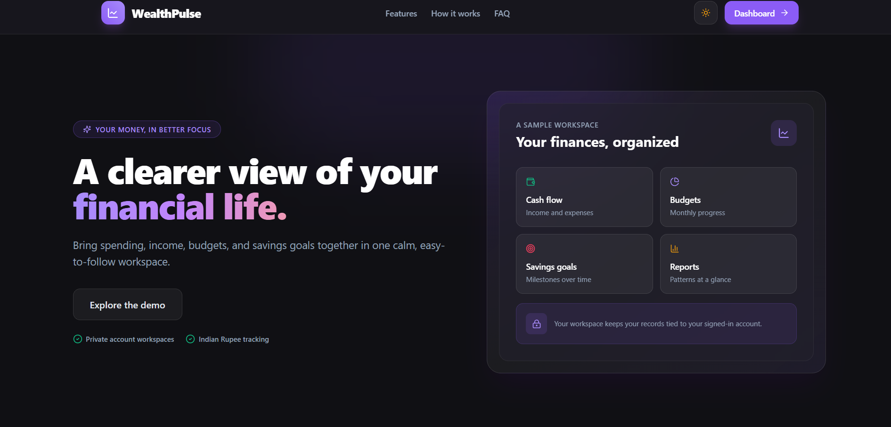
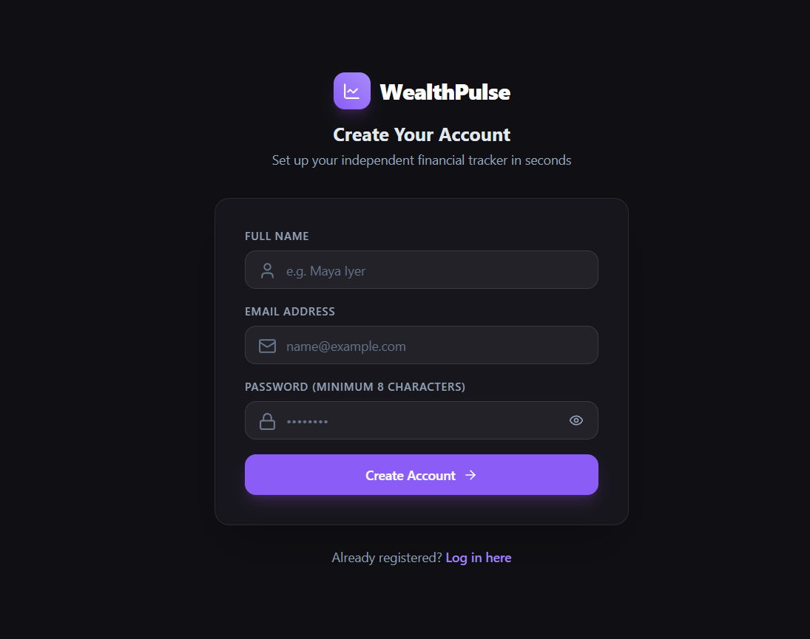
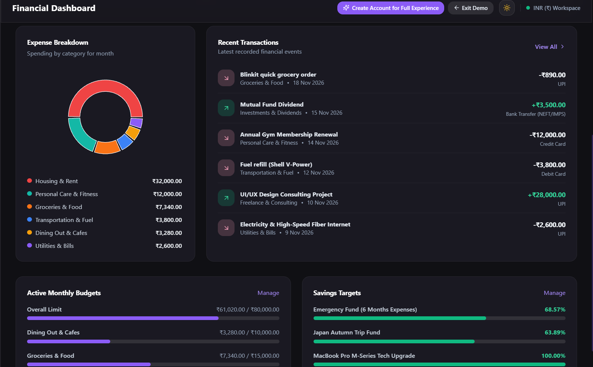
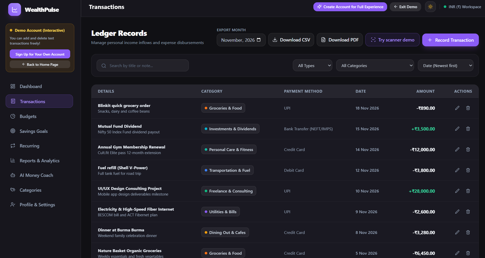
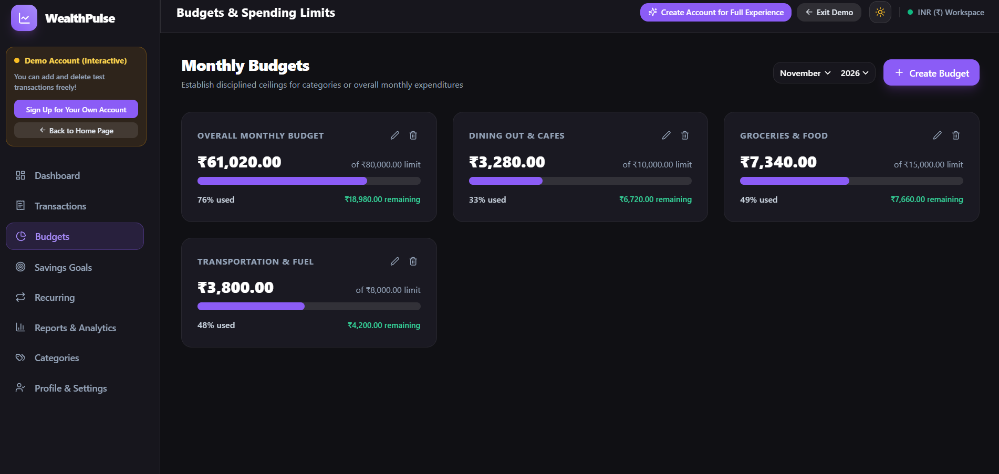
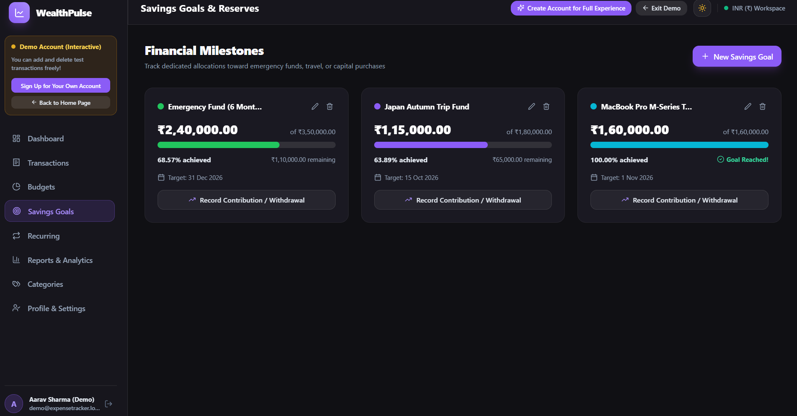
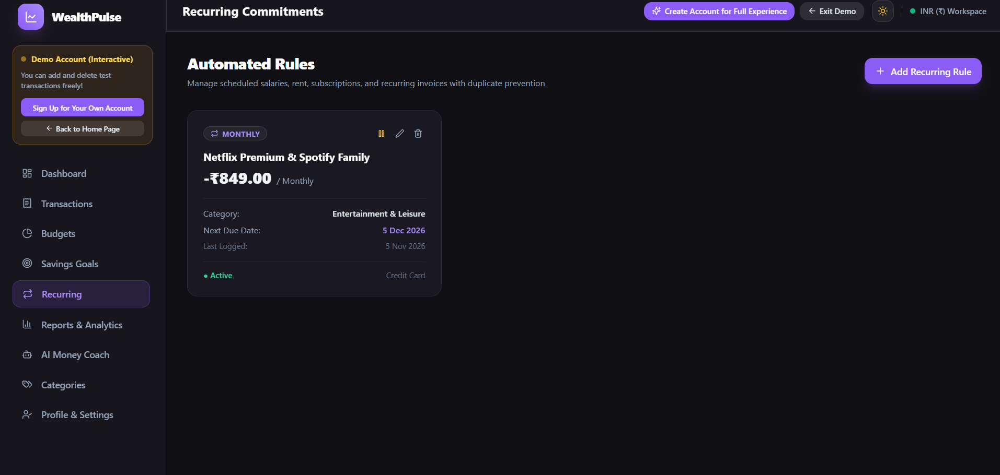
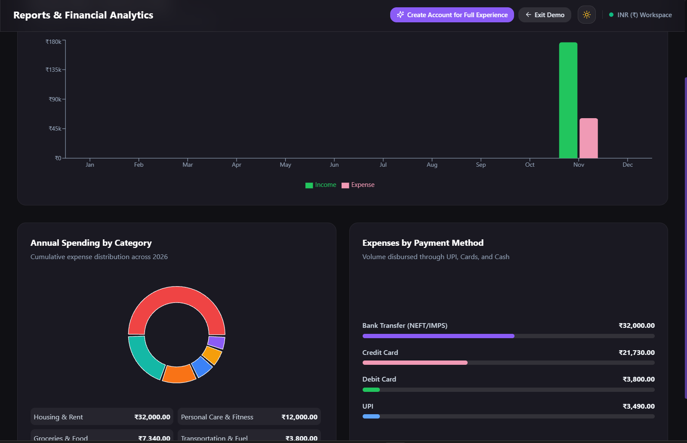
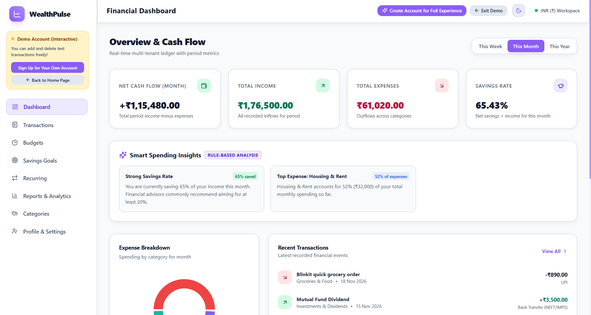
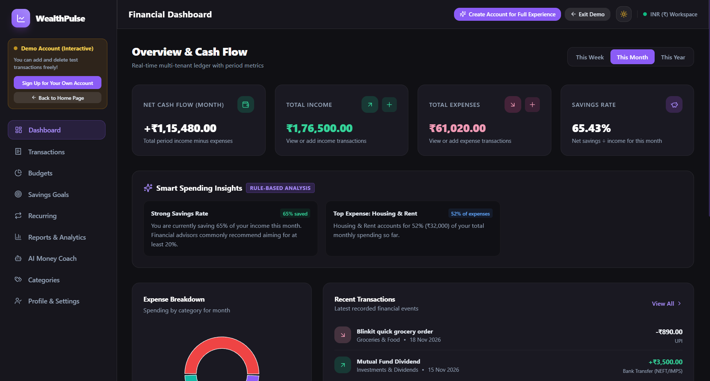

# WealthPulse

WealthPulse is a personal finance tracker for recording income and expenses, setting budgets and savings goals, and reviewing monthly cash flow. It includes a dashboard, reports, recurring transaction rules, and downloadable monthly transaction reports.

**Live application:** [wealth-pulse-money-manager.vercel.app](https://wealth-pulse-money-manager.vercel.app/)

**Backend API health:** [wealth-pulse-lake.vercel.app/api/health](https://wealth-pulse-lake.vercel.app/api/health)

## Features

- Account registration, sign in, profile preferences, and password changes.
- Income and expense tracking with categories, dates, notes, and payment methods.
- Search, category and type filters, sorting, and pagination for transactions.
- Monthly budget tracking with spending progress and over-budget amounts.
- Savings goals with contributions and withdrawals.
- Recurring transaction rules for regular income and expenses.
- Dashboard **summaries**, **charts**, **reports**, and **rule-based financial insights**. Insights are calculated from account data; no AI service is used.
- Monthly transaction exports in **CSV** and **PDF**. The PDF preview includes total income, total expenses, and net cash flow.
- Interactive demo account and **dark** and **light** themes.
- Optional email verification and password recovery when SMTP delivery is configured. Without SMTP, recovery is unavailable; signed-in users can change their password in Profile settings.

## Technology stack

| Area | Technologies |
| --- | --- |
| Frontend |**React 18, Vite, React Router, Tailwind CSS, Recharts, Lucide React**|
| Backend | **Node.js, Express 4, Mongoose** |
| Database | **MongoDB Atlas** |
| Validation | **Zod** |
| Authentication | **bcryptjs password hashing, JSON Web Tokens, HTTP-only cookies** |
| Email | **Nodemailer with SMTP configuration** |
| Security | **Helmet, CORS, express-rate-limit** |
| Backend checks | **Node.js test runner, Supertest, mongodb-memory-server** |
 Version Control | **Git,GitHub** |


## Screenshots

### Landing page



### Login and registration



### Dashboard




### Transactions and downloads



### Budgets



### Savings goals



### Recurring 



### Reports and analytics



### Light and dark themes





## Project structure

```text
.
├── backend/
│   ├── index.js          # Vercel serverless Express entry point
│   ├── src/
│   │   ├── config/       # Environment and database setup
│   │   ├── controllers/  # API handlers
│   │   ├── middleware/   # Authentication, validation, rate limits, errors
│   │   ├── models/       # Mongoose models
│   │   ├── routes/       # Express routes
│   │   ├── services/     # Email, insights, recurring transactions
│   │   ├── utils/        # Tokens, currency, seed helpers
│   │   ├── validators/   # Zod request schemas
│   │   ├── app.js        # Express middleware and route setup
│   │   └── server.js     # Configuration, database connection, listener
│   ├── tests/            # Backend API tests
│   └── package.json
├── frontend/
│   ├── public/           # Static assets and favicon
│   ├── src/
│   │   ├── components/   # Shared UI and layout
│   │   ├── context/      # Authentication and theme state
│   │   ├── pages/        # Application screens
│   │   ├── services/     # API client
│   │   ├── utils/        # Formatting helpers
│   │   ├── App.jsx       # Application routes
│   │   └── main.jsx      # React entry point
│   ├── index.html
│   ├── vite.config.js
│   └── package.json
├── README.md
└── DEPLOYMENT.md
```

## Clone and run

### Requirements

- Node.js 18 or newer and npm.
- A MongoDB connection for persistent account data.

### 1. Clone the repository and install dependencies

```bash
git clone <repository-url>
cd <repository-directory>
cd backend
npm install
cd ../frontend
npm install
cd ..
```

### 2. Configure environment variables

Create your own `backend/.env` and `frontend/.env` files. These files are ignored by Git and must never be committed. Frontend `VITE_` variables are included in the browser build, so do not put secrets in the frontend environment.

#### Frontend environment variables

| Variable | Required | Purpose |
| --- | --- | --- |
| `VITE_API_URL` | No | API base URL, ending in `/api`. Defaults to `/api`. This is public configuration. |

Example `frontend/.env`:

```env
VITE_API_URL=http://localhost:5000/api
```

#### Backend environment variables

| Variable | Required | Purpose |
| --- | --- | --- |
| `JWT_SECRET` | Yes | Private key used to sign authentication tokens. |
| `COOKIE_SECRET` | Production | Cookie-parser secret; must be at least 32 characters in production. |
| `MONGODB_URI` | Production | MongoDB connection URI. Optional for development. |
| `FRONTEND_URL` | Production | Exact HTTPS frontend origin allowed by CORS and authenticated requests. |
| `PORT` | No | API port; defaults to `5000`. |
| `NODE_ENV` | No | Runtime mode, such as `development` or `production`. |
| `EMAIL_HOST` | No | SMTP host. Required with `EMAIL_USER` and `EMAIL_PASS` to enable email. |
| `EMAIL_PORT` | No | SMTP port; defaults to `587`. |
| `EMAIL_USER` | No | SMTP username. |
| `EMAIL_PASS` | No | Private SMTP password. |
| `EMAIL_FROM` | No | Sender address used for email. |

Example `backend/.env`:

```env
NODE_ENV=development
PORT=5000
MONGODB_URI=<your-mongodb-connection-uri>
JWT_SECRET=<your-private-development-value>
COOKIE_SECRET=<your-private-cookie-value>
FRONTEND_URL=http://localhost:5173

# Optional: omit these to keep email verification and password recovery disabled.
EMAIL_HOST=
EMAIL_PORT=587
EMAIL_USER=
EMAIL_PASS=
EMAIL_FROM=WealthPulse <noreply@example.test>
```

All backend credentials must remain in the backend environment and must not use the `VITE_` prefix. Production requires `MONGODB_URI` and `FRONTEND_URL`; `JWT_SECRET` and `COOKIE_SECRET` must each be at least 32 characters. Keep `.env` files private.

### 3. Start the backend

```bash
cd backend
npm run dev
```

The API listens on `http://localhost:5000`. Its health endpoint is `http://localhost:5000/api/health`.

### 4. Start the frontend

In a second terminal, from the repository directory:

```bash
cd frontend
npm run dev
```

Open `http://localhost:5173`. Vite forwards `/api` requests to the backend.

## Deployment

- **Frontend:** Deployed on Vercel
- **Backend:** Deployed on Vercel (Serverless Functions)
- **Database:** MongoDB Atlas
- **Live Website:** https://wealth-pulse-money-manager.vercel.app/

The application is deployed as a full-stack web application with cloud-hosted frontend, backend APIs, and database infrastructure.

## Security overview

Passwords are hashed with bcryptjs. Authentication uses seven-day JWTs in HTTP-only cookies. Password changes invalidate previous sessions, protected data is scoped to the authenticated account, request bodies are validated, and sensitive authentication endpoints are rate-limited. Helmet provides security headers. Keep private backend credentials out of frontend configuration and source control.

Email verification and password recovery require configured SMTP delivery. Without SMTP, the application does not create or log mock links, and password recovery is disabled. Users who are signed in can change their password from Profile settings.

## Future improvements

- Configure a production **email provider** for **account verification** and **email-based password recovery**.
- Add optional bank transaction imports.
- Add more export formats and customizable report periods.
- **AI Integration:** Personalized AI finance chatbot, AI-powered receipt and bill scanning, automated transaction generation, and intelligent financial insights.

## Author
### DIVYA RAVINDRA PAI
Engineering student
